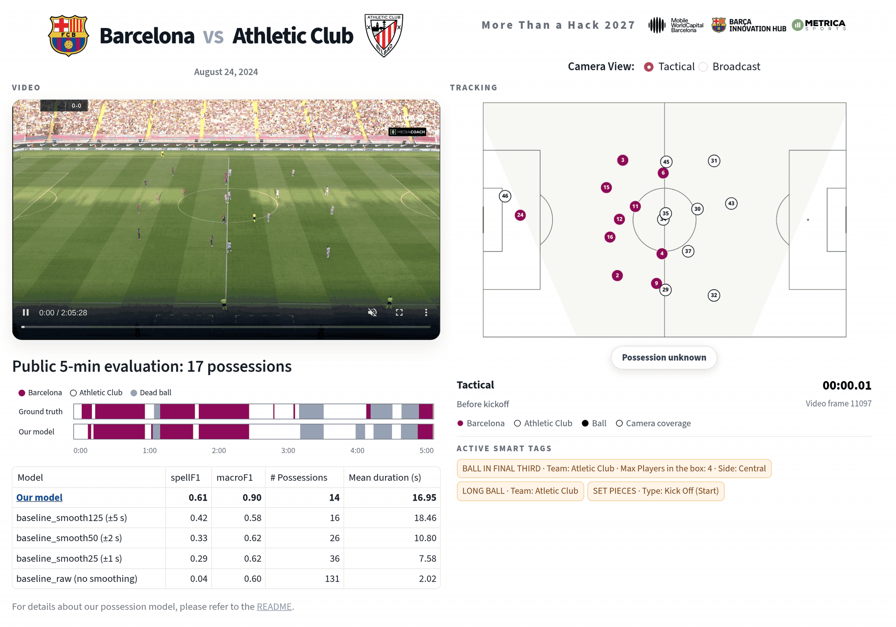

# Who Has the Ball Possession?

**Technical report · More than a Hack 2027 · Round 1**

## Abstract

We predict team possession and stoppages from player and ball tracking coordinates for
Barcelona–Athletic Club, August 24, 2024. Two histogram-based gradient boosting classifiers
estimate dead-ball probability and the possessing team during live play. A Viterbi decoder
converts frame predictions into continuous possession intervals. The final classifiers are
trained on 20 external SkillCorner matches; Barcelona–Athletic labels do not enter fitting.
On the public five-minute window, the exported predictions achieve **0.6065 spellF1** and
**0.8963 macroF1**, compared with **0.4242** and **0.5812** for the strongest listed baseline
by spellF1. These are development results, not blind-test or full-match estimates.

This README is the submission's Markdown technical document. It describes the implemented
system, its data sources, possession rules, evaluation, and reproduction steps.
The accompanying dashboard supports visual inspection; the scored artifact is the prediction CSV.

## Task and approach

The output contains one label for each of the tactical video's **199,319 frames at 25 Hz**:
`H` for home-team possession (Barcelona), `A` for away-team possession (Athletic Club),
`D` for dead ball, and `X` outside the graded halves. The aim is to recover team possession
intervals, including their boundaries, rather than assign possession to whichever player
happens to be closest in each frame.

Boosted trees provide nonlinear decisions over geometric and temporal features without
requiring a video model or a large manually annotated training set. Separating dead/live
play from team possession lets the two classifiers use different inputs and supervision.
Sequence decoding discourages brief label changes caused by tracking noise or deflections.
The nearest-player baselines provide a simpler comparison; no controlled comparison with
neural sequence models or video-based models is claimed.

## Data and asset use

| Asset | Use in this system |
| --- | --- |
| Provided tactical tracking and metadata | Player/ball coordinates, team membership, pitch geometry, frame alignment, and half boundaries for inference. |
| Provided tactical and broadcast video | Dashboard playback and visual inspection. Video pixels are not classifier inputs. Observed kickoff instants also inform the fixed policy disclosed below. |
| Provided broadcast tracking | Separate dashboard view; not used to produce the tactical submission. |
| Provided homographies | Visible-pitch shading in the dashboard; not classifier inputs. |
| Provided automatic Smart Tags | Displayed for context; not used as features or training targets. |
| Public Barcelona–Athletic labels | Pipeline checks and reported evaluation on 7,500 frames; excluded from classifier fitting. |
| Four supplied nearest-player baseline CSVs | Evaluation comparisons only; not training targets. |
| SkillCorner tracking, match metadata, and phases of play | External training and held-out evaluation data, described below. |

The active implementation has no video detector, Smart Tag prior, second-stage classifier,
or synthetic coordinate augmentation. The retained experiment record documents feature
simplification: duplicate and unused inputs and redundant smoothed team centroids were
removed. It does not establish that every unused asset was experimentally tested and rejected.

### Training labels and provenance

All fitted labels come from **20 matches** in
[SkillCorner Open Data at the pinned revision](https://github.com/SkillCorner/opendata/tree/4340d274572876239c154c90bc507a9b3250a656),
released through SkillCorner's joint initiative with PySport. SkillCorner supplies the
tracking and Game Intelligence phase annotations; our code converts the provider's
`team_in_possession_id` and phase boundaries into frame labels. We did not manually label
these matches. Individual annotators or human-review procedures are not documented in
our provenance record, so these targets are treated as **provider-derived weak labels**,
not independently verified human ground truth.

The provider describes phases as present during live play in its
[dataset documentation](https://raw.githubusercontent.com/SkillCorner/opendata/4340d274572876239c154c90bc507a9b3250a656/README.md).
The [adapter](model/datasets.py) assigns `H` or `A` inside those intervals and assumes their
complement within each half is `D`; outside the halves it assigns `X`. Phase ends are
exclusive and clipped to their declared period. Missing or incomplete phase annotations
can therefore produce incorrect dead-ball targets. The tracking file's separate possession
field is audited for disagreement but is not the training-label source.

The [training audit](model/reports/training.json) records **1,182,244 labelled half frames
at 10 Hz** before subsampling: **320,341 H**, **309,889 A**, and **552,014 D** (about 32.8 hours).
The final fit uses all 20 matches. The separate validation experiment fits on 16 matches
and evaluates four withheld matches; its match lists are in the
[validation report](model/reports/validation.json). Neither fit includes Barcelona–Athletic.
The downloader pins the source revision and records file checksums in
`data/skillcorner/manifest.json`.

## Pipeline

1. **Prepare tracking.** Convert coordinates to a consistent pitch representation, remove
   implausible ball jumps, and interpolate ball gaps of at most **0.4 seconds**. Longer gaps
   remain missing. Extract temporal features separately within each half.
2. **Fit two classifiers.** The dead-ball classifier uses **121 inputs**; the conditional
   team-possession classifier uses **108** and is fitted only on live-play targets. Training
   samples every second frame at SkillCorner's 10 Hz rate. Both team perspectives are used
   in fitting and averaged symmetrically at inference.
3. **Predict the target match.** Apply the fixed learned weights to tactical tracking at
   its native frame rate. Video and target-match labels do not enter feature construction.
4. **Decode intervals.** Optimize a three-state `H/A/D` sequence independently for each half.
5. **Export.** Apply the fixed pre-kickoff policy below, set frames outside graded halves
   to `X`, and validate the CSV. The dashboard reads this same exported file.

Both classifiers use **600 rounds**, learning rate **0.05**, at most **31 leaves per tree**,
minimum leaf size **400**, L2 regularization **1**, seed **0**, and no early stopping.
Team-possession training weights are `clip(8 seconds / possession duration, 0.25, 4)`
per frame, reducing the dominance of long possessions. Dead-ball fitting is unweighted.
See [configuration](model/config.py) and [classifier implementation](model/core/classifiers.py).

### Features

Inputs describe ball availability and motion; pitch boundaries; player proximity and
control; inferred touches; team shape and movement; ball position relative to each team;
and stop/restart context. Temporal windows include one- and three-second averages and
time since/until observations, control, or out-of-bounds events. These are coordinate-derived
signals, not manually annotated target-match events.

The [complete feature inventory](model/FEATURES.md) lists every selected input and its
classifier assignment. Future-looking windows and next-event features make this an
**offline system**, not a causal live predictor.

### Decoder

Let `pD` be the dead-ball probability and `pH` the home-possession probability conditional
on live play. The frame scores are:

```text
H: 0.75 × log(1 − pD) + 2.0 × log(pH)
A: 0.75 × log(1 − pD) + 2.0 × log(1 − pH)
D: 0.75 × log(pD)
```

Probabilities are clipped to `[0.0001, 0.9999]`. Viterbi decoding maximizes the sum of
these scores minus fixed transition costs:

| From → To | H | A | D |
| --- | ---: | ---: | ---: |
| H | 0 | 64 | 40 |
| A | 64 | 0 | 40 |
| D | 40 | 40 | 0 |

Internal dead-ball intervals must last at least **one second**; intervals touching half
boundaries are exempt. These are costs, not transition probabilities. The
[decoder](model/core/decode.py) uses evidence across the complete half.

## Implemented possession rules

| Situation | Operational treatment |
| --- | --- |
| Controlled possession | A control feature requires a player within 1.5 m of a ball moving below 12 m/s, with the nearest opponent at least 0.5 m farther away. This is evidence for the classifier, not a direct final-label rule. |
| Passes and loose balls | No separate contested state is emitted. Motion, previous/next control, and transition penalties allow possession to continue through a pass or loose-ball interval. Missing ball coordinates alone do not force `D` or `X`. |
| Challenges and deflections | A touch candidate uses a ball-velocity change of at least 5 m/s near a player within 2.5 m, with a 0.5 m proximity advantage. A touch does not automatically transfer possession; the decoder requires enough cumulative evidence to pay the switching cost. |
| Stoppages and restarts | Dead-ball probability uses geometry, stillness, movement, and temporal context. Decoding chooses entry to and exit from `D`; there is no separate referee-whistle or restart-type detector. |
| Half boundaries | Features and decoding reset at each half; frames outside the graded halves receive `X`. |

**Match-specific exception:** [model/match_policy.py](model/match_policy.py) hard-codes
observed kickoff frames and forces tactical frames **110,808–113,741 inclusive** to `D`
after decoding. Frame **113,742** remains predicted. This changes the second-half setup
interval and does not affect the first-half public score. It is a fixed match-specific
override, not a learned or generally applicable kickoff detector.

## Evaluation

The [scorer](evaluation/possession_metrics.py) matches home/away possession intervals
one-to-one using temporal intersection-over-union. **spellF1** averages interval F1 over
IoU thresholds **0.3, 0.4, 0.5, 0.6, and 0.7**; **macroF1** averages frame-level F1 over
`H/A/D`. Frames with reference label `X` are excluded.

| Experiment | spellF1 | macroF1 | Interpretation |
| --- | ---: | ---: | --- |
| Final model on its 20 training matches | 0.8019 | 0.9392 | In-sample, equal-match means |
| Separate 16-match fit on four withheld SkillCorner matches | 0.7287 | 0.9198 | Equal-match means; reused development holdout |
| Final model on Barcelona public five minutes | 0.6065 | 0.8963 | Target-match development check |

All comparisons below use the same **7,500 public frames and 17 reference possessions**:

| Model | spellF1 | macroF1 | Predicted possessions |
| --- | ---: | ---: | ---: |
| **Our model** | **0.6065** | **0.8963** | **14** |
| Nearest player, ±5 s smoothing | 0.4242 | 0.5812 | 16 |
| Nearest player, ±2 s smoothing | 0.3256 | 0.6207 | 26 |
| Nearest player, ±1 s smoothing | 0.2868 | 0.6200 | 36 |
| Nearest player, no smoothing | 0.0378 | 0.5972 | 131 |

The model improves over these baselines on this window, but high frame agreement does
not imply accurate interval recovery. The gap between macroF1 and spellF1 and the lower
predicted interval count indicate remaining segmentation errors. These aggregates alone
do not identify which football situations caused each error. See the
[results](model/RESULTS.md), [training report](model/reports/training.json), and
[baseline descriptions](evaluation/baselines/README.md).

## Run

These commands reproduce the active model and its submission from the input data.
Pinned dependencies are in `Pipfile.lock`; use the recorded six-thread configuration.

Install **Python 3.14**, [Pipenv](https://pipenv.pypa.io/), and **FFmpeg**.
Run all commands from the repository root, using one Pipenv environment.
Pipenv manages the Python environment; `pipenv --venv` shows its location.

### 1. Install and download data

```bash
git clone https://github.com/hadisotudeh/more-than-a-hack-2027.git
cd more-than-a-hack-2027
pipenv sync
pipenv run python tools/setup_data.py
```

The [setup script](tools/setup_data.py) downloads and places:

| Data | Location |
| --- | --- |
| Hackathon videos, tracking, homographies, and Smart Tags from [Google Drive](https://drive.google.com/drive/folders/18KTDrUQX4sZXFfWnRcz09-FTehburY_K) | `data/tactical/` and `data/broadcast/` |
| 20 SkillCorner training matches | `data/skillcorner/` |

Setup also creates the app's playback videos and reuses existing files on reruns.
You need permission to access the competition data. If Drive requires sign-in or blocks
automated downloads, download the bundle in your browser, then run:

```bash
pipenv run python tools/setup_data.py --bundle /path/to/bundle.zip
```

`--bundle` also accepts a TAR archive or extracted folder. To use a different match-data
folder, set `MTAH_DATA_DIR` for setup, training, and the app. SkillCorner data stays in the repository’s `data/skillcorner/` folder.
See the [data setup guide](data/README.md) for folder and access details.

### 2. Train on SkillCorner and predict Barcelona–Athletic

This command fits the classifiers on the 20 external SkillCorner matches, then applies
them to Barcelona–Athletic tracking data. It does not fit or update weights on Barcelona–Athletic.

```bash
pipenv run python -m model.run --threads 6
```

Training saves weights and frame probabilities in `model/artifacts/`, records results in
[`model/reports/training.json`](model/reports/training.json), and automatically exports
the validated **`model/our_model.csv`**. Data, fitted weights, caches, and submissions stay out of Git.
See the [model guide](model/README.md) for training and export details.

### 3. Export the submission

Training already creates the submission. To regenerate it from saved probabilities without retraining:

```bash
pipenv run python -m model.submission
pipenv run python evaluation/validate_submission.py model/our_model.csv
```

The generated artifact is **`model/our_model.csv`**: columns `frame,label`, **199,319 rows**, frames **0–199318**,
and labels `H/A/D/X`. This is the single prediction CSV used for both upload and the app.
Export prints public scores and saves `model/our_model.validation.json` with its SHA-256 checksum and label counts.
Compare that receipt against the exact file being submitted. For the submission form,
copy the CSV and this README to files named after the registered team (`<team_name>.csv`
and `<team_name>.md`), and supply the public repository URL. Renaming must not change CSV contents.

### 4. Start the app

```bash
pipenv run streamlit run app/main.py
```

The app reads the same submission CSV. Run it and the browser on the same computer.
See the [app guide](app/README.md) for camera inputs and playback alignment.
For tests and recording tools, install `pipenv sync --dev`. After setup and training,
run `pipenv run python -m pytest tests`.


## Demo



[View the 20-second GIF at full size](docs/assets/app-demo.gif).


## Repository layout

| Folder | Purpose |
| --- | --- |
| `app/` | Streamlit dashboard and video/tracking components |
| `model/` | Training, CSV export, [configuration](model/config.py), and feature definitions |
| `model/artifacts/` | Generated model weights, probabilities, and training snapshot; ignored by Git |
| `model/reports/` | [Training provenance](model/reports/training.json) and [held-out results](model/reports/validation.json) |
| `data/` | Downloads in `tactical/`, `broadcast/`, and `skillcorner/`; ignored by Git |
| `evaluation/` | Scorer and validator; labels in `ground_truth/`, baseline CSVs in `baselines/` |
| `tests/` | App, model, and data-setup checks |
| `tools/` | Data setup and GIF/video recording with shared browser utilities |
| `docs/` | Demo assets and local video exports |


## Licence

Code and documentation use the [MIT licence](LICENSE), with adapted-code exceptions
explained in [source provenance](model/PROVENANCE.md). Match assets have separate competition terms.
[Media asset credits](tools/assets/README.md) cover the logo used in video exports.

[SkillCorner Open Data](https://github.com/SkillCorner/opendata/tree/4340d274572876239c154c90bc507a9b3250a656)
is released under the [MIT licence](https://github.com/SkillCorner/opendata/blob/4340d274572876239c154c90bc507a9b3250a656/LICENSE),
© 2020 SkillCorner. Credit to SkillCorner and its joint open-data initiative with [PySport](https://pysport.org/).
